# Plan: spreadsheet upload for package owners

Launch checklist item 18. **This is a plan for the owner's approval. Nothing is
built yet, and the pull request that carries it is not for merge.**

A business with a Multi-listing package can create many Mzansi Market posts at
once by filling in a spreadsheet. Each row becomes a private draft. The owner
adds photos and sends the drafts for review. Every rule that applies to one
post applies to every row, and every post still goes through staff review.

**How to answer:** the decisions are numbered **D1 to D22** in
[section 14](#14-decisions-for-the-owner). Reply "approve all 22", or name the
numbers you want changed, for example "approve all except D7 and D15".

## Contents

1. [In short](#1-in-short)
2. [How one post is made today](#2-how-one-post-is-made-today)
3. [How other sites do it](#3-how-other-sites-do-it)
4. [The flow, step by step](#4-the-flow-step-by-step)
5. [The template columns](#5-the-template-columns)
6. [How many rows, and how that relates to slots](#6-how-many-rows-and-how-that-relates-to-slots)
7. [Rows with errors](#7-rows-with-errors)
8. [Photos and video](#8-photos-and-video)
9. [Drafts first, then sending for review](#9-drafts-first-then-sending-for-review)
10. [Safety](#10-safety)
11. [Database and server work](#11-database-and-server-work)
12. [What it costs to run](#12-what-it-costs-to-run)
13. [How it fits with item 17 and the frontend rules](#13-how-it-fits-with-item-17-and-the-frontend-rules)
14. [Decisions for the owner](#14-decisions-for-the-owner)
15. [Build order and tests](#15-build-order-and-tests)
16. [Sources](#16-sources)

## 1. In short

- **Who:** accounts with an active Multi-listing package. It starts from the
  package card on **My slots**.
- **What:** Mzansi Market posts, one category per file. Business profiles,
  tourism and events stay one at a time.
- **How:** download a template, fill it in with Excel or Google Sheets, upload
  it, see which rows are ready and which need fixing, then create drafts from
  the ready rows.
- **Photos:** not by web link. The sheet can name the photo files; the owner
  then picks all the photos at once and the site matches them to drafts by
  file name. Anything left over is added in the normal edit form.
- **Going live:** the owner ticks the drafts and presses "Send for review".
  Each post takes a slot and goes to the same review queue as any other post.
- **Limits:** 2 MB and 100 rows per file, never more drafts than the account
  may hold (5 plus the number of slots in the package).
- **Database:** two new private tables and three new `api.*` commands. Nothing
  existing changes. Apply-first.
- **Cost:** no new paid service. The only thing that grows with use is photo
  processing, which is the same as posting those photos one by one.

## 2. How one post is made today

These are the rules each spreadsheet row must meet. They come from the current
code; the bulk path calls the same database checks, so it cannot skip any.

| Rule | Today, for one post | Where it is checked |
| --- | --- | --- |
| Who may post | Signed in, ID review accepted, phone proof, confirmed location | Form gate and `internal.assert_posting_verification_ready` at submit |
| Category | One of 11 Mzansi Market categories | `api.create_core_draft` checks the category |
| Title | 5 to 100 characters, no hidden or look-alike characters | Form, `internal.save_post_content`, `internal.submit_post` |
| Description | 20 to 5,000 characters, no hidden characters | Same |
| Price | Amount in rand (up to 2 decimals, up to R99,999,999), free, or price on request. "Negotiable" only with an amount. Jobs: no "free", no "negotiable" | Form, `internal.validated_listing_terms` |
| Location | Province and city required; suburb and street optional | `resolveRestoredLocality`, database foreign keys |
| Category details | Required details per category, choices from fixed lists, years and numbers in range | `parseListingAttributes`, `internal.validate_listing_attributes` |
| Contact | Private message is always on; WhatsApp and call need a verified phone | `internal.assert_post_contacts_ready` |
| Photos | At least 1 (not for jobs), up to the plan's limit (10 photos, 1 video for a package). JPEG, PNG or WebP up to 5 MB; MP4 video up to 50 MB and 120 seconds | Upload route, `internal.set_post_media`, `internal.submit_post` |
| Photo safety | File type checked by content, malware scan, re-encoded, location data removed from video | `uploadFoundationMedia` |
| Posting terms | Current version (`posting-v5`) accepted | `internal.accept_posting_terms`, checked again at submit |
| Drafts | At most 5 plus the slots in the account's packages | `api.create_core_draft` |
| Slots | A post takes a package slot when it is sent for review. A package allows 4 new posts per slot per rolling 30 days | `internal.activate_post` |
| Review | Every post waits for staff approval. Nothing goes live on its own | `internal.submit_post` sets "pending review"; staff use `api.moderate_post` |
| Speed limits | Creating posts: 10 a minute and 30 an hour per connection. Photo uploads: 20 requests a minute | Rate limiter worker |

There is no spreadsheet import, bulk post creation or spreadsheet library in
the project today. The only spreadsheet code is an organisation report export,
which already protects against formulas in cells.

## 3. How other sites do it

| Site | Template | Check before saving | Errors | Photos | Drafts |
| --- | --- | --- | --- | --- | --- |
| eBay (Seller Hub Reports) | Download a template by type; CSV or Excel; required columns coloured | Processed after upload | Results file of what happened to each row | Web links, or left blank on the drafts template and added when the draft is finished | Yes, a "create drafts" template |
| Shopify | Sample CSV | Preview before import | Import stops with a list of problems | Public web links only | Yes, a status column can make products drafts |
| Amazon Seller Central | Excel file per category, with drop-down choices and an instructions sheet | Processed after upload | Processing report per row | Web links | No |
| Takealot | Excel load sheets for bulk work | Not documented publicly | Not documented publicly | Not documented publicly | Not documented publicly |
| Bob Shop | CSV for advanced sellers, up to 1,000 items at once | Not documented publicly | Not documented publicly | A separate bulk image upload | No |
| Facebook Commerce Manager | Catalogue feed from a file, a scheduled link or Google Sheets | Processed after upload | Feed issues list | Web links | No |

The Amazon and Facebook rows describe their well-known seller tools and were
not re-checked for this plan; the other rows are from the sources in section 16.

**What we take from them**

- A template per category with drop-down choices and a "How to fill this in"
  sheet (Amazon, eBay). Owners never have to guess an allowed value.
- Check every row before anything is saved, and show the problems in plain
  words beside the row (Shopify's preview, eBay's results file).
- Create drafts first (eBay's drafts template). Nothing goes live from the
  upload itself.
- Photos added after the drafts exist, not by web link (eBay allows blank
  photos on drafts; Bob Shop has a separate photo upload). Web links are the
  most common source of failed imports elsewhere, because private Google Drive
  or Dropbox links cannot be fetched, and fetching them would make our server
  download whatever a stranger points it at.

**What we leave out for now:** scheduled feeds, links to dealer stock systems,
and an API. Small South African businesses mostly keep stock in Excel or
Google Sheets; feeds suit large dealers and can come later (D21).

## 4. The flow, step by step

Four steps on one page (template, upload, check, create drafts), then the
drafts list. The clickable mock-ups are static HTML in
[`mock/`](mock/01-entry.html): open `01-entry.html` in a browser and click
through. Each picture below is at phone width (390) and desktop width (1280).
A dashed gold outline marked **New** shows what is added to an existing screen.

### Step 1: where it starts (My slots)

The package card gets one new button, "Add posts from a spreadsheet". The empty
places tile gets a second link beside "Create a post". Nothing else on the page
changes.

| Phone | Desktop |
| --- | --- |
| 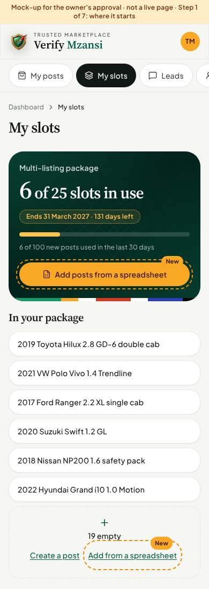 | 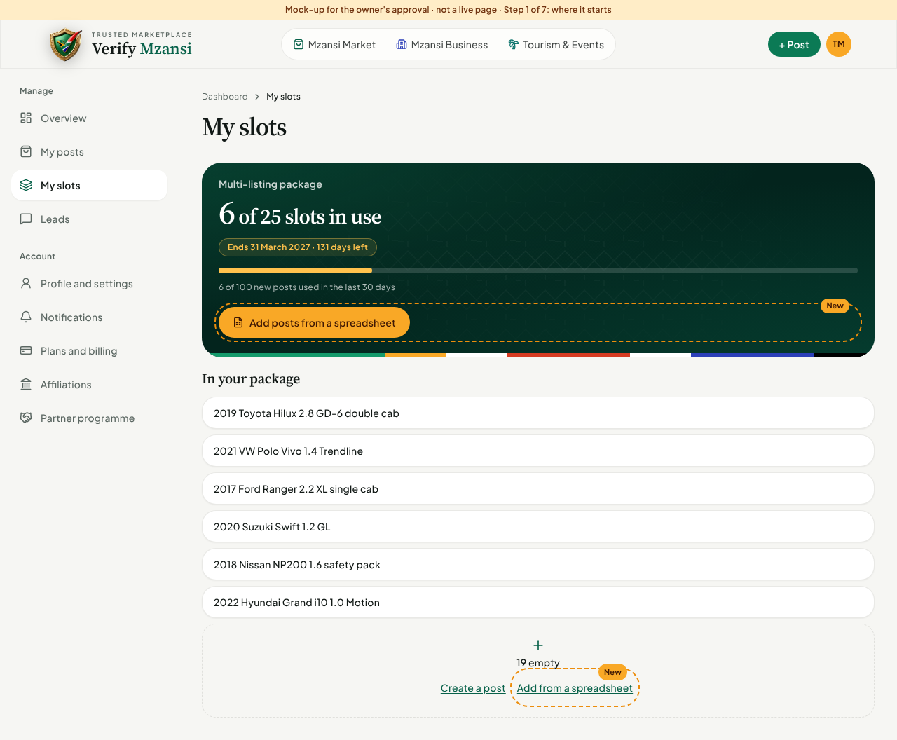 |

### Step 2: get the template

Pick the category, then download the Excel template (CSV is offered too). The
side panel lists the columns for that category. "I already have a filled-in
file" skips straight to the upload.

| Phone | Desktop |
| --- | --- |
| 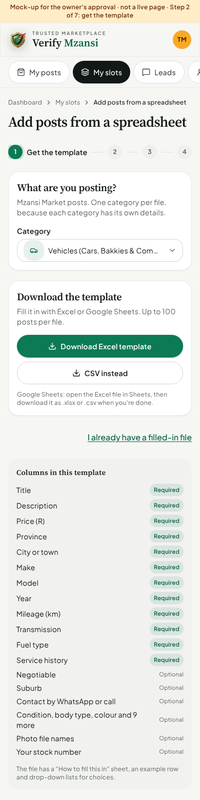 | 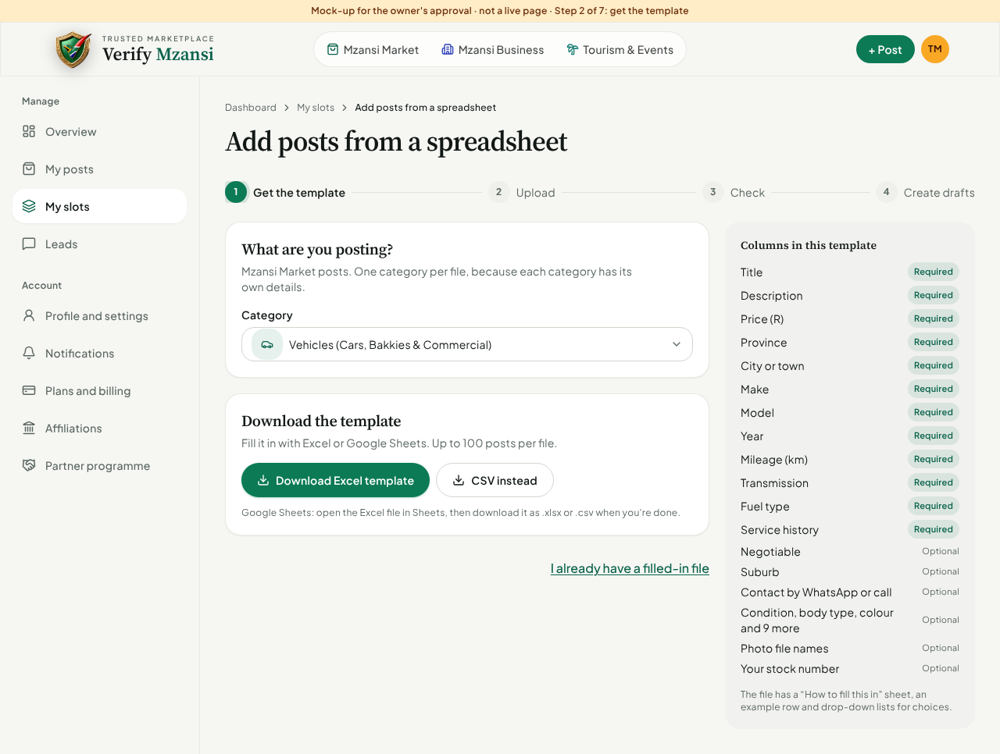 |

### Step 3: upload

Drop the file or choose it. The page says how many drafts the account can add
right now. The file is read in the browser; nothing is saved yet.

| Phone | Desktop |
| --- | --- |
| 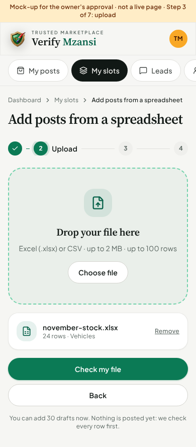 | 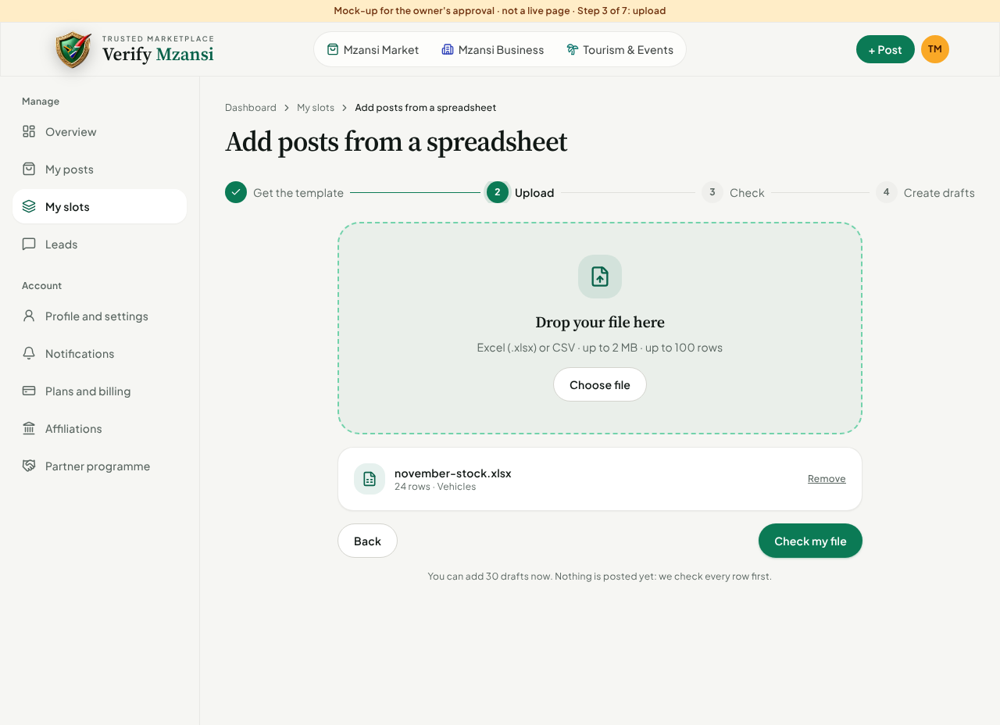 |

### Step 4: check results

Counts first (ready, need fixing, free slots), then the rows. Each problem
names the column and says how to fix it. Filters show only the rows that need
fixing. A missing photo is a warning, not an error: the row still becomes a
draft. The owner can download the rows to fix, or carry on with the ready rows.

| Phone | Desktop |
| --- | --- |
| 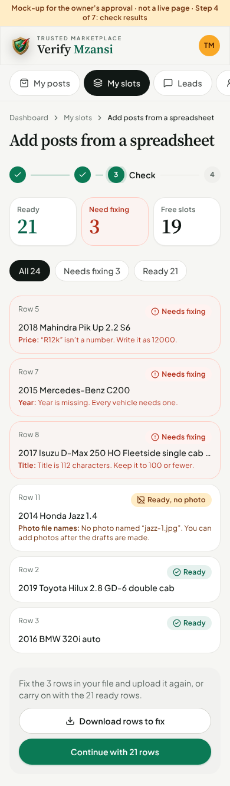 | 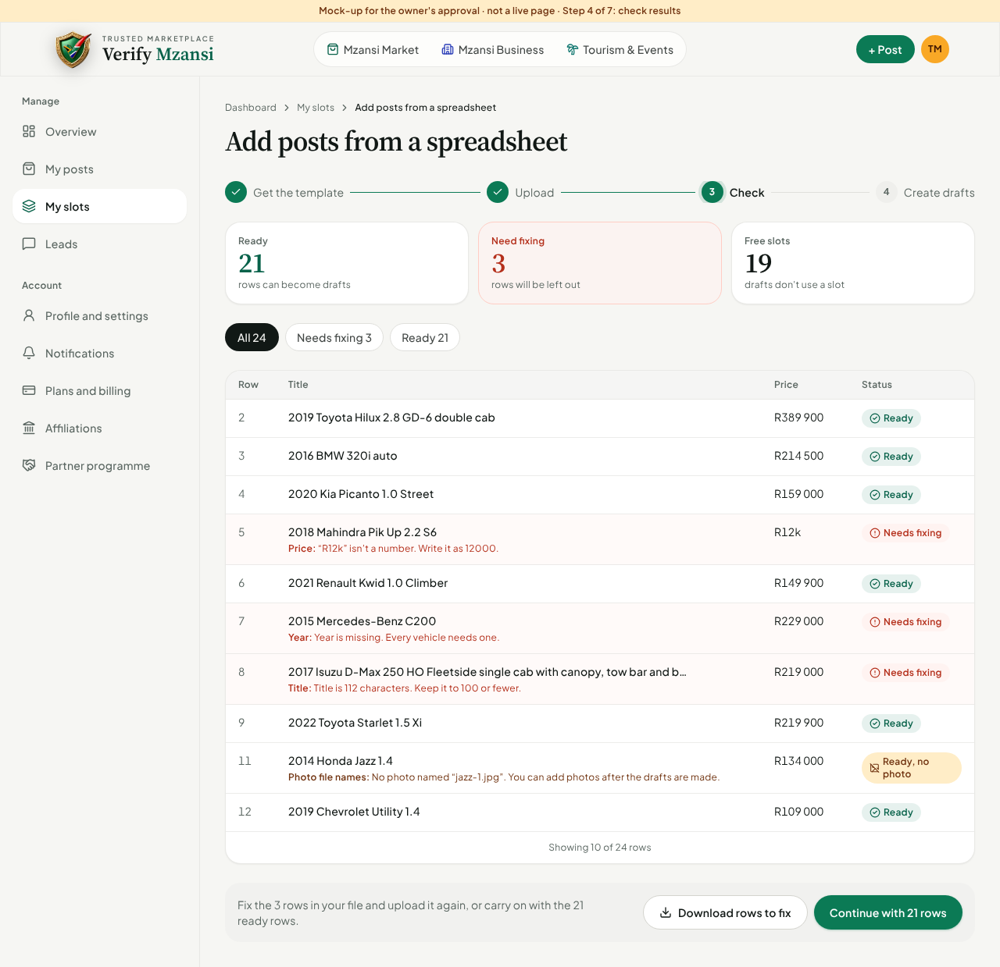 |

### Step 5: confirm

A short summary and the same posting terms tick box as the post form, worded
for several posts. The button names the outcome: "Create 21 drafts".

| Phone | Desktop |
| --- | --- |
| 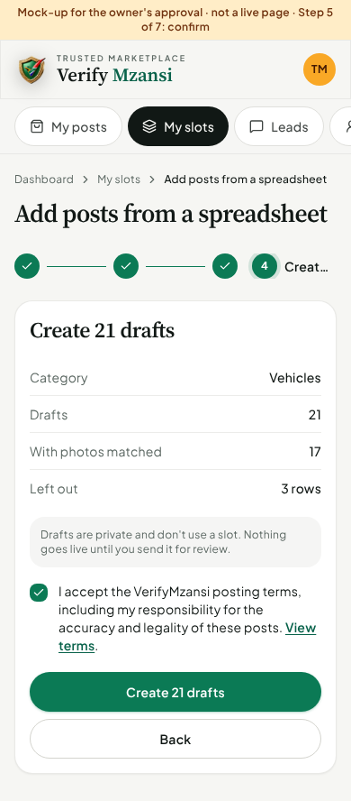 | 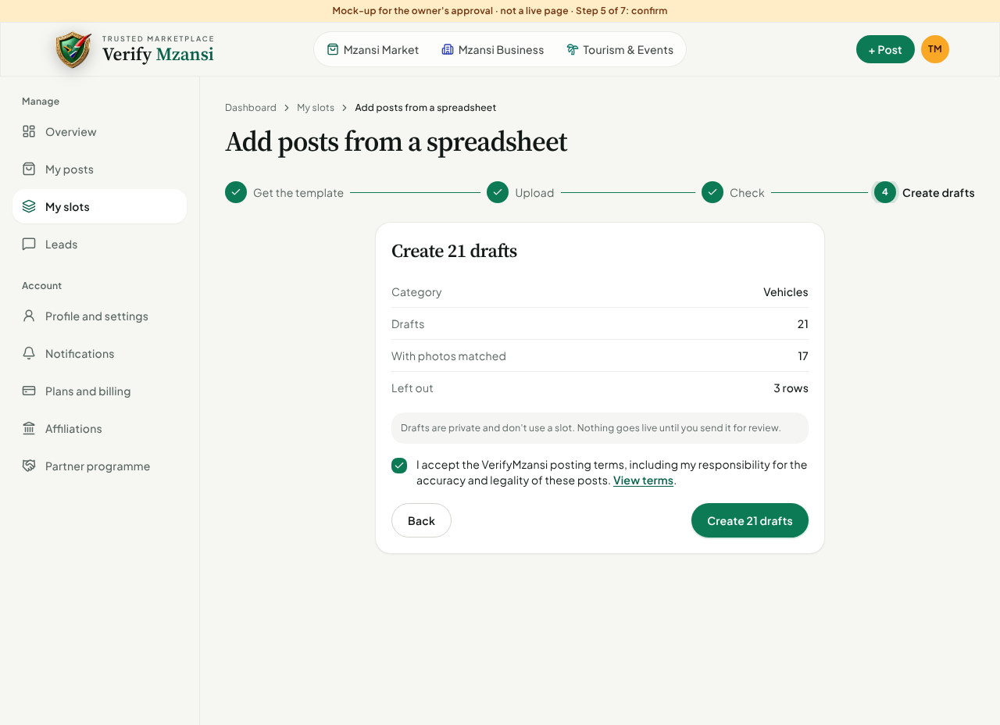 |

### Step 6: done

How many drafts were made, how many still need a photo, and a link to download
the rows that were left out. One main action: "Add photos and send for review".

| Phone | Desktop |
| --- | --- |
| 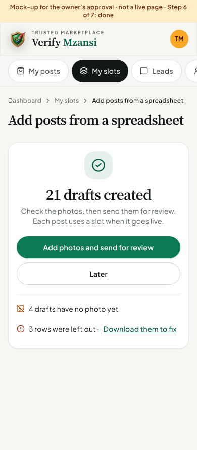 | 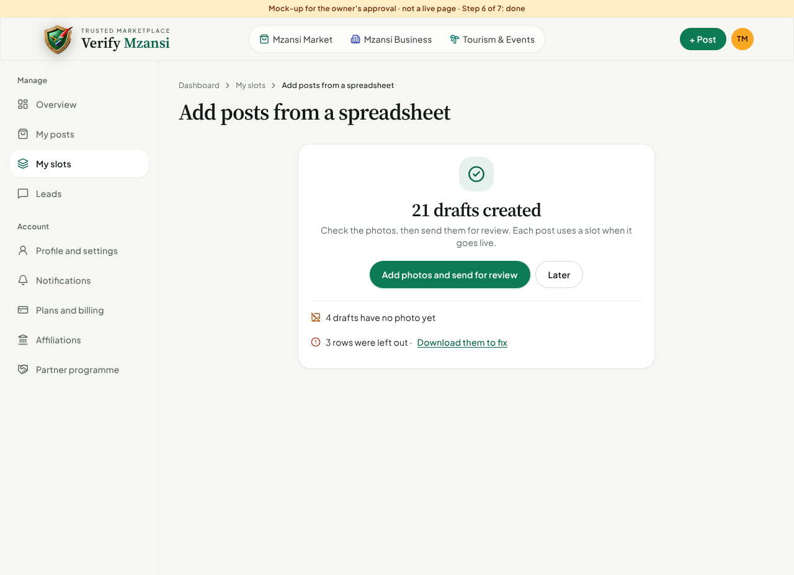 |

### Step 7: photos and send for review

The drafts from this file, in **My posts**. "Choose photos" takes all the
photos at once and matches them by file name. Each draft can also be opened in
the normal edit form. Drafts with a photo are ticked; the bar at the bottom
says how many slots sending will use. This bar should be the same selection
bar as the item 17 bulk actions (D19).

| Phone | Desktop |
| --- | --- |
| 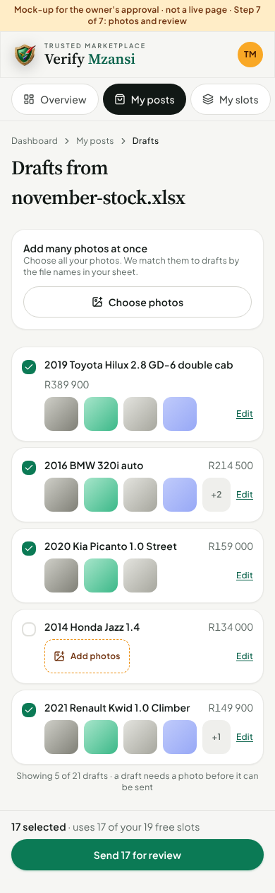 | 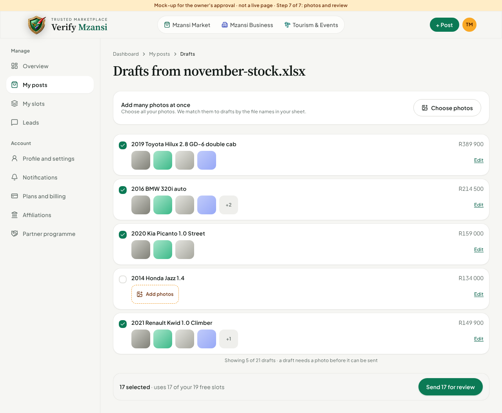 |

## 5. The template columns

Each template has three sheets:

1. **Posts**: the columns below, one row per post, with one example row in
   grey that the check ignores.
2. **How to fill this in**: one line per column, what is required, and the
   allowed values.
3. **Choices** (hidden): the lists behind the drop-downs.

Column headings are plain words ("Fuel type", not `fuel_type`). The check
matches headings by name, so columns can be moved around. Choices are typed or
picked as shown ("Diesel"); the check accepts any letter case.

### Columns in every template

| Column | Required | Rule |
| --- | --- | --- |
| Title | Yes | 5 to 100 characters |
| Description | Yes | 20 to 5,000 characters |
| Price (R) | Yes, except Jobs | A number such as 12000 or 12000.50. Write "Free" or "On request" instead of a number if that applies |
| Negotiable | No | Yes or No. Only with an amount |
| Province | Yes | Drop-down of the 9 provinces |
| City or town | Yes | Drop-down of the site's cities and towns; common other spellings are accepted |
| Suburb | No | Up to 120 characters |
| Condition | No (not for Jobs) | New, Like new, Good, Fair, For parts |
| Contact by WhatsApp or call | No | WhatsApp, Call, Both or blank. Private messages are always on |
| Photo file names | No | Up to 10 file names, separated by commas, for example `hilux-1.jpg, hilux-2.jpg` |
| Your stock number | No | Up to 40 characters. Private: only the owner sees it, to find the post again |

### Extra columns per category

Required details are marked with an asterisk in the template. Checklist details
(several ticks, such as vehicle extras) are left out of the sheet and can be
added in the edit form, to keep the sheet simple (D5).

| Category | Required | Optional |
| --- | --- | --- |
| Property (For Sale & To Rent) | Property type, For sale or to rent | Bedrooms, Bathrooms, Parking spaces, Floor size, Erf or stand size, Furnished, Pets allowed, Levy, Rates and taxes, Property sub-type, Swimming pool, Garden, Domestic quarters or flatlet, Garages, Carports, Fibre internet, Available from |
| Vehicles (Cars, Bakkies & Commercial) | Make, Model, Year, Mileage (km), Transmission, Fuel type, Service history | Body type, Colour, Variant or trim, Engine size, Drive type, Doors, Previous owners, Accident free, Registration province, Finance available, Trade-in accepted |
| Vehicle Parts & Accessories | Part type, Part condition | Compatible makes, Compatible models, OEM or aftermarket, Warranty included, Fitment included, Compatible years |
| Electronics & Tech | Device type, Brand | Model, Storage, Screen size, Warranty, Network lock, Battery health, RAM, Original accessories, Activation lock cleared |
| Furniture & Home | Item type | Material, Brand, Dimensions, Delivery available, Power rating |
| Jobs | Job type, Location type | Industry, Experience level, Qualification required, Salary period, Company name, Employment equity, Application deadline |
| Farming & Agriculture | Farm category | Livestock type, Breed, Age, Quantity available, Equipment condition, Farm size, Irrigation, Delivery available |
| Baby & Kids | Item type | Age group, Gender, Brand, Safety certified (SABS), Delivery available |
| Clothing & Accessories | None | Material, Brand, Dimensions, Delivery available |
| Sports, Hobbies & Leisure | None | Item type, Material, Brand, Dimensions, Delivery available |
| Other Items | None | Material, Brand, Dimensions, Delivery available |

Some details only apply after another choice (a vehicle's model needs a make;
a farm's breed applies only to livestock). The check uses the same rules as the
post form for these.

The templates are made from the same category list the post form uses
(`src/lib/domains/taxonomy/reference.json`), so a new category or detail
changes the template too. A test fails if a template and the category list
disagree.

## 6. How many rows, and how that relates to slots

Three separate numbers apply, and the screens show each one where it matters.

| Limit | Value | Why |
| --- | --- | --- |
| Rows per file | 100 | Enough for most stock lists; larger packages upload in a few files. Keeps the check quick on a phone |
| Drafts the account may hold | 5 plus the slots in the package (a 25-slot package holds 30 drafts) | Existing database rule (`internal.draft_allowance`) |
| Posts sent for review | Free slots in the package, and 4 new posts per slot per 30 days | Existing package rules (`internal.activate_post`) |

- **Drafts do not use a slot.** A post takes a slot only when it is sent for
  review, exactly as today.
- **Too many rows:** if a file has more ready rows than the account can hold as
  drafts, the check says so before anything is saved ("You can add 30 drafts
  now. Your file has 42 ready rows. Remove 12 rows, or finish or delete some
  drafts first.") Rows are never cut off silently (D7).
- **Sending more than the free slots:** the "Send for review" button counts only
  as many as will fit and says why ("19 free slots, so you can send 19").
- **Daily ceiling:** at most 300 rows a day per account, in the database, so
  repeatedly creating and deleting drafts cannot flood the system (D14).

## 7. Rows with errors

- **Errors stop a row, never the whole file.** Ready rows can become drafts
  while the others are fixed.
- **Warnings do not stop a row:** a photo file name that will need a photo, a
  title that appears twice in the file, or a title the owner already uses on
  another post.
- **Every message says what is wrong and how to fix it**, names the column, and
  shows the row number as Excel shows it, for example:
  - Price: "R12k" isn't a number. Write it as 12000.
  - Year: Year is missing. Every vehicle needs one.
  - Title: Title is 112 characters. Keep it to 100 or fewer.
  - Transmission: "Auto" isn't one of the choices. Pick Manual or Automatic.
  - City or town: We don't know "Joburg CBD". Pick from the list, or use the
    nearest town.
- **Download rows to fix:** an Excel file with only the rows that need fixing,
  in the owner's own columns, plus an "Error" column. After fixing, the owner
  uploads that file. Rows already made into drafts are not made twice.
- **Phase 1 has no in-page editing grid.** Fixing in the spreadsheet the owner
  already uses is simpler to build and to learn. An editing grid can come later
  if owners ask (D8).
- **Unknown columns** are ignored with a note ("We ignored the column 'Cost
  price'"), so the owner's own working columns do no harm.

## 8. Photos and video

**Recommendation: no web links; match photo files by name (D9, D10).**

1. The sheet's "Photo file names" column lists the photo files for each row.
   It is optional.
2. After the drafts are made, the owner presses "Choose photos" and selects all
   the photos at once (from a folder on a computer, or the gallery on a phone).
3. The browser matches files to drafts by name, ignoring letter case, and shows
   the result before uploading. The first name in a row is the cover photo.
4. Photos upload through the existing photo upload, 10 files per request, with
   all its checks: file type by content, 5 MB per photo, malware scan,
   re-encoding, and the package's 10-photo limit.
5. Drafts with no matched photos show "Add photos". The owner can drop photos on
   that draft, or open it in the normal edit form.

Why not the other ways:

| Option | Problem |
| --- | --- |
| Web links in the sheet | The server would have to fetch addresses a stranger chooses. That can be abused to reach internal systems or to make the site download huge files. Private Drive or Dropbox links fail anyway. It also makes copying photos from other sellers easy |
| A zip file of photos | Zip files can hide huge contents in a small download, need unpacking on the server, and are awkward on phones |
| Photos only in the edit form | Safe, but slow for 50 posts. Kept as the fallback for anything not matched |

**Video:** not in the spreadsheet. Video needs conversion in the browser before
upload today and is one per post; it is added in the edit form (D11).

## 9. Drafts first, then sending for review

- **Every ready row becomes a private draft** (D12). Drafts appear in **My
  posts** with the existing Draft badge, can be opened in the normal edit form,
  and can be deleted. The upload itself never sends anything for review.
- **Posting terms are accepted once at the confirm step**, with the same
  version check as the post form. If the terms change before the drafts are
  sent, the owner is asked to accept the new version, exactly as when editing a
  post today (D13).
- **"Send for review"** sends the ticked drafts (D15). For each one, the
  database runs the same submit checks as a single post: verification,
  contact, at least one photo, terms, a free slot and the 30-day new-post
  allowance. A draft that fails stays a draft, with the reason shown beside it.
- **Staff review is unchanged.** Posts from a spreadsheet join the same queue
  and need the same approval. Staff see a small "From a spreadsheet" note so
  they can review similar posts together (D16).
- **Drafts stay drafts** until the owner sends or deletes them. An unsent draft
  never goes live and never uses a slot.

## 10. Safety

| Risk | Plan |
| --- | --- |
| Very large or harmful files | 2 MB file limit, 100 rows, 60 columns. The file is read in the browser and never sent to the server; the server receives only the rows as text (at most 512 KB per request) |
| Formulas in the owner's file | The values Excel shows are read, never formulas. A cell that still starts with "=" is refused with "Remove the formula from this cell" |
| Formulas in files we hand out (formula injection) | The templates and the "rows to fix" file start any cell beginning with `=`, `+`, `-`, `@`, tab or line break with an apostrophe, so Excel shows it as text. This reuses the existing organisation report helper (`csvCell`), moved to a shared place |
| Hidden or look-alike characters | The same checks as the post form, in the browser and again in the database |
| Fetching web addresses | None. No column is fetched by the server. A web link in "Photo file names" gets the message "Photo links aren't supported. Add the photo files instead" |
| Skipping a rule | The browser check is only for speed. The server repeats it with the same code, and the database repeats every rule it already enforces for single posts |
| Too many requests | New rate-limiter actions keyed by account as well as connection: checking is in the browser; creating drafts at most 5 times per 10 minutes and 20 times a day; sending for review at most 10 times an hour. Photo uploads keep today's limit |
| Repeated clicks or a dropped connection | Each create and send request carries an ID; repeating it returns the first answer instead of making duplicates, like the single-post path |
| Someone else's account | The commands act only on the signed-in owner's own drafts and photos, with the same session, same-site and CSRF checks as every owner route |
| Privacy | The file is not stored. The database keeps the import's file name, row numbers, photo file names and stock numbers for 30 days so the photo step and "rows to fix" work, then removes them |

## 11. Database and server work

**Yes, it needs new `api.*` commands.** Doing it with the existing single-post
command would mean one request per row, which the per-connection speed limit
(30 an hour) would block, and would lose the per-row results. All rules are
reused from the existing internal functions; none is copied.

### New database pieces (one update file, apply-first)

| Piece | What it does |
| --- | --- |
| `private.post_imports` | One row per upload: owner, category, file name, row count, drafts made, request ID, time. Kept 30 days |
| `private.post_import_rows` | One row per spreadsheet row that became a draft: row number, draft, photo file names, stock number. Owner-only |
| `api.import_my_listing_drafts(p_request, p_category, p_file, p_rows, p_terms)` | Creates up to 100 drafts in one call. Checks: active package, verified poster, current posting terms (records acceptance), draft room for the whole batch, the 300-rows-a-day ceiling. Each row goes through `internal.create_core_draft`, `internal.save_post_content`, `internal.validated_listing_terms`, `internal.save_listing_attributes` and `internal.set_post_contacts`. A row that fails is reported and does not stop the others. Repeating the same request ID returns the same result |
| `api.get_my_post_import(p_import)` | The drafts from one upload, with their status, photo count, photo file names and stock numbers, for the photo step |
| `api.submit_my_drafts(p_request, p_posts)` | Sends up to 50 of the owner's drafts for review. Each one goes through `internal.submit_post`, which already checks verification, contacts, photos, terms and slot limits and takes the slot. Results per draft |

Attaching photos to a draft reuses the existing `api.set_post_media`; no new
command is needed for it. (The existing `api.submit_post` could send drafts one
at a time, but one request per draft would meet the per-connection speed limit
and give no combined result, so a batch command is recommended.)

**Order:** apply-first. The update only adds tables and commands; the live
website does not use them until the code ships. Nothing is renamed or removed,
so no contract step is needed. Proof before the pull request:
`pnpm test:foundation:native`, the replay and contract steps in
`database/foundation/README.md`, and native tests that every refusal of the
single-post path is also a row error in the import (same input, same refusal).

### New server and browser pieces

| Piece | What it does |
| --- | --- |
| Shared row check | One module used by the browser and the server: column matching, the post form's existing rules (title, price, location, category details, hidden characters), and friendly messages |
| Spreadsheet reading | In the browser only, loaded only on this page: a small Excel reader (`read-excel-file`) and a CSV reader (`papaparse`). Both are widely used and MIT-licensed. Final choice checked against the dependency rules at build time (D17) |
| Templates | Made by a script from the category list when the site is built, saved as static files, with a test that they are current (D18). No server work per download |
| Routes | `/api/foundation/post-imports` (create drafts), `/api/foundation/post-imports/[id]` (read one upload), `/api/foundation/post-imports/send` (send for review). All through the existing owner-route wrapper: session, same-site, CSRF, body size, rate limit |
| Rate limiter | Two new actions in `workers/rate-limiter.ts`, keyed by account and connection |
| Screens | The upload page under `/dashboard/slots/upload`, the drafts list in My posts, and the new button and link on My slots. All behind a hidden-feature switch until they work |

## 12. What it costs to run

The feature adds no new paid service. Figures are the providers' published free
allowances at the time of writing.

| Service | Free allowance | What one upload of 100 rows uses |
| --- | --- | --- |
| Cloudflare Workers | 100,000 requests a day | About 15 requests (page, create, read, about 10 photo upload requests, send). The site's Worker settings already use Workers Paid features, which include far more |
| Spreadsheet reading | Not a server cost | Done in the owner's browser |
| Templates | Not a server cost | Static files, cached |
| Supabase database | 500 MB | About 0.5 MB of draft text per 100 rows; import records are removed after 30 days |
| Cloudflare R2 (photo storage) | 10 GB stored, 1 million uploads a month | Depends on photos. Each account's storage is already capped by the existing media allowance |
| Cloudflare Images (photo re-encoding) | 5,000 unique transformations a month on the free plan; $0.50 per 1,000 after that on Workers Paid | Roughly 1 to 3 per photo. 100 posts with 5 photos each could use 500 to 1,500. **This is the only cost that grows with use**, and it is the same as posting those photos one by one. When the allowance runs out, uploads already stop with a clear message |
| Rate limiter | Existing Durable Object | A few extra checks per upload |
| Staff time | Not a hosting cost | More posts arrive in the review queue at once. Package rules already cap new posts at 4 per slot per 30 days |

## 13. How it fits with item 17 and the frontend rules

**Item 17** (approved plan: bulk Pause, Mark sold and Reactivate, copying a
post, and templates) and this upload solve different sizes of the same job:

- **Copy a post / templates (item 17):** best for 2 to 10 similar posts, done
  on the site.
- **Spreadsheet upload (item 18):** best for 10 or more posts kept in a stock
  list.
- **Bulk actions (item 17):** once posts exist, item 17's selection bar pauses,
  marks sold or reactivates many at once. The "Send for review" bar in step 7
  should be the same component with one more action, so owners learn one
  pattern (D19).
- Item 17 is designed separately; this plan only assumes it ships first or at
  the same time.

**Frontend rules (AGENTS.md):** every screen here is new or changes an existing
screen, so all of it needs the owner's approval of these pictures before it is
built. When built, each change goes in the frontend change ledger, and the
feature stays behind a hidden-feature switch until it works end to end on the
test copy (D20). Multi-listing packages are not on sale on the live site
today; the upload would be switched on when they are.

## 14. Decisions for the owner

Each decision is a question with a recommendation. "Approve all 22" accepts
every recommendation.

| # | Question | Recommendation |
| --- | --- | --- |
| D1 | Who can use it? | Only accounts with an active Multi-listing package. Individual slot holders post one at a time |
| D2 | Which posts? | Mzansi Market posts in all 11 categories. Business profiles, tourism places and events stay one at a time |
| D3 | Where does it start? | One button on the package card on My slots, and one link in the empty-places tile (step 1 pictures) |
| D4 | One template or one per category? | One per category, with drop-down choices, an instructions sheet and one example row |
| D5 | Category checklist details (such as vehicle extras)? | Left out of the sheet; added in the edit form |
| D6 | Which file types? | Excel (.xlsx) and CSV. Google Sheets users download either from Sheets. No Google account connection |
| D7 | Limits? | 2 MB and 100 rows per file; never more than the drafts the account may hold. Too many rows: say so before saving, never cut silently |
| D8 | What happens to rows with errors? | Left out; the owner creates drafts from the ready rows and downloads the rows to fix as an Excel file with an "Error" column. No editing grid in phase 1 |
| D9 | Photos by web link? | No. The server never fetches addresses from a spreadsheet |
| D10 | How do photos get in? | Optional "Photo file names" column, then "Choose photos" matches files by name and uploads them through the normal checks. Everything else in the edit form. No zip files |
| D11 | Video? | Not in the spreadsheet; added in the edit form |
| D12 | Drafts or straight to review? | Drafts first, always |
| D13 | Posting terms? | Accepted once on the confirm screen, using the post form's wording adapted to "these posts"; the version check still applies when sending |
| D14 | Daily ceiling? | 300 rows a day per account, plus the rate limits in section 10 |
| D15 | How are drafts sent? | Tick drafts, "Send N for review". Each goes through the normal submit checks and takes a slot; failures stay drafts with the reason shown |
| D16 | Anything different for staff? | Same queue and same approval; a small "From a spreadsheet" note on the review screen |
| D17 | Which libraries? | `read-excel-file` and `papaparse`, in the browser, loaded only on the upload page |
| D18 | How are templates made? | Built from the category list when the site is built, with a test that keeps them current |
| D19 | Selection bar for sending? | Reuse item 17's bulk-action bar, with "Send for review" added |
| D20 | When does it go live? | Behind a hidden-feature switch until it works on the test copy, then switched on once Multi-listing packages are on sale |
| D21 | Feeds, dealer system links or an API? | Not now. Revisit if large dealers ask |
| D22 | Updating existing posts by re-uploading a sheet (for example new prices)? | Not now. Phase 1 creates new drafts only; edits stay in the edit form and item 17's bulk actions |

## 15. Build order and tests

Each step is its own pull request, after the owner approves this plan and the
pictures.

1. **Database update** (apply-first): the two tables and three commands, with
   native tests, including the "same input, same refusal" tests against the
   single-post path, the draft room, the daily ceiling, repeat requests and
   another owner's drafts.
2. **Shared row check and templates:** the check module with unit tests for
   every message, the template script, and the test that templates match the
   category list. The formula-safe cell helper moves to a shared place, with
   tests.
3. **Routes and rate limits:** the three routes and two limiter actions, with
   route tests for size limits, session, same-site, CSRF and rate limits.
4. **Screens** (hidden): exactly as approved in these pictures; ledger entries;
   accessibility checks with the existing axe tests.
5. **End-to-end test** on the foundation test copy: a package owner uploads a
   file with good and bad rows, fixes the bad rows, adds photos by file name and
   sends drafts for review; staff approve; the posts go live and use slots.
6. **Switch on** when Multi-listing packages are on sale.

## 16. Sources

- eBay, Seller Hub Reports and bulk listing:
  [ebay.com help](https://www.ebay.com/help/selling/selling-tools/seller-hub-reports?id=4096),
  [eBay export guide](https://export.ebay.com/en/services-tools/seller-hub/uploading-your-listings-in-bulk-using-reports-tab/)
- Shopify, product CSV problems and image links:
  [Shopify help](https://help.shopify.com/en/manual/products/import-export/common-import-issues)
- Bob Shop, bulk listing and bulk images:
  [Bob Shop help](https://help.bobshop.co.za/portal/en/kb/articles/10-bobshop-tools-all-sellers-should-know-about),
  [Uploading images in bulk](https://help.bobshop.co.za/portal/en/kb/articles/uploading-images-in-bulk),
  [bidorbuy help](https://www.bidorbuy.co.za/help/1103/How_Do_I_List_Multiple_Items_Bulk_Listing_Or_Uploading)
- Takealot bulk tools:
  [Takealot seller help](https://help.takealot.com/hc/en-us/sections/4410512674578-Bulk-Tools-Seller-API-Do-more-in-less-time)
- Cloudflare Images pricing:
  [Cloudflare docs](https://developers.cloudflare.com/images/pricing)
- This repository: `src/app/post/create-listing/page.tsx`,
  `src/lib/foundation/restored-post-route.ts`,
  `database/foundation/current/functions/internal/{create_core_draft,consume_frontend_post_command,submit_post,activate_post,draft_allowance}.sql`,
  `src/lib/domains/taxonomy/reference.json`, `src/lib/billing/slot-packages.ts`,
  `workers/rate-limiter.ts`, `src/app/api/organisations/[id]/report/route.ts`.
